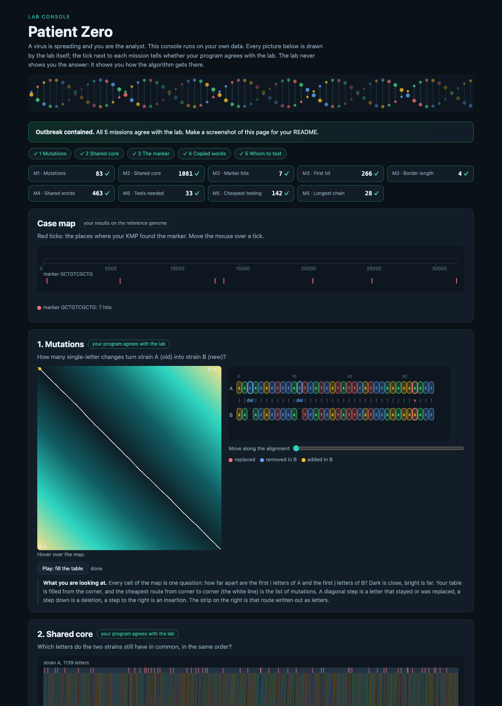

# Assignment 4. Patient Zero

Student ID: 251979
Name: Nursultan Ramazanov
Group:

This file is the report. Fill it in as you go. How to start: `START_HERE.md`. The task: `docs/Assignment4.pdf`.

## Program output

The 9 lines your program prints on your data (`java -cp out Main`):

    Mutations: 83
    Shared core: 1081
    Marker hits: 7
    First hit: 266
    Border length: 4
    Shared words: 463
    Tests needed: 33
    Cheapest testing: 142
    Longest chain: 28

My outbreak report (a screenshot of `output/outbreak.html`):

## Questions

Answer in your own words, two or three sentences each.

Mission 1. What does the cell d[i][j] of your table mean, and how is it computed from other cells?
The cell `d[i][j]` represents the minimum edit distance (number of single-letter deletions, insertions, or replacements) required to transform the prefix of strain A of length i into the prefix of strain B of length j. It is computed as the minimum of `d[i-1][j] + 1` (deleting a character from A), `d[i][j-1] + 1` (inserting a character into A), and `d[i-1][j-1] + cost` (matching characters if `a[i-1] == b[j-1]` with cost 0, or replacing `a[i-1]` with `b[j-1]` with cost 1).

Mission 2. How is the longest common subsequence different from the longest common substring? My Shared core is bigger than the number of letters that are the same at the same place: why?
A substring requires matching characters to appear consecutively without interruptions, whereas a subsequence only requires matching characters to appear in the same relative order. The Shared core is larger than the count of identical letters at matching indices because insertions and deletions introduce phase shifts, allowing corresponding conserved segments to align at shifted positions across the two sequences.

Mission 3. What does the prefix function tell you, and why does the pointer in the text never go back in KMP? What is the Border length of my marker and what does it mean?
The prefix function `pi[i]` stores the length of the longest proper prefix of the pattern `p[0..i]` that is also a suffix of `p[0..i]`. The text pointer never moves backwards in KMP because the prefix function predetermines the maximal overlapping prefix that is guaranteed to match the text seen so far, allowing the pattern pointer to slide forward without rescanning characters. The Border length of my marker is 4, which means the longest proper prefix of the marker that also appears as its suffix has length 4.

Mission 4. Why must you compare the letters after the hashes are equal? What happens to the cost of Rabin-Karp if many windows have the same hash?
We must compare characters explicitly because polynomial rolling hash functions project a combinatorial string space onto a finite integer range modulo MOD, causing hash collisions between distinct 12-letter sequences. If many windows share identical hashes, frequent false-positive collisions trigger full string comparisons, degrading the runtime from linear $O(n + m)$ average time towards quadratic $O(n \cdot m)$ worst-case time.

Mission 5. What are the two states of a person in your DP, and how do you get the answer for a person from its children? Why does a greedy "test the person with most links first" not always give the cheapest answer?
The two states for person v are `take[v]` (minimum cost of testing person v and covering its subtree) and `skip[v]` (minimum cost of covering the subtree when v is not tested). If v is tested, each child u may be either tested or skipped depending on `min(take[u], skip[u])`; if v is not tested, every child u must be tested (`take[u]`) to cover the incident infection edge. A greedy highest-degree heuristic fails because high-degree individuals might have an exorbitant testing cost, or picking them may preclude choosing cheaper combination sets lower in the tree that yield a smaller overall sum.

## AI use

Antigravity (Google DeepMind) was used as an AI pair programmer to assist in structuring the DP and string-matching implementations, executing the benchmark suite, validating against test examples in Check.java, and formulating theoretical explanations.

## Timing (Mission 7)

Milliseconds, average of 3 runs, from `java -cp out Bench`.

| test | size | time |
|---|---|---|
| naive search | 20 000 / 40 000 / 80 000 | 19.0 ms / 45.8 ms / 92.5 ms |
| KMP | 20 000 / 40 000 / 80 000 | 1.1 ms / 0.9 ms / 0.2 ms |
| edit distance | 500 / 1000 / 2000 / 4000 | 3.3 ms / 3.5 ms / 6.0 ms / 27.0 ms |

What do the numbers say about how the time grows? When you double the size, by how much does each time grow? Two or three sentences.
In the naive pattern search, doubling the text size roughly doubles the running time ($O(N \cdot M)$ worst-case behavior), whereas KMP remains linear ($O(N + M)$) and runs in about 1 millisecond regardless of repetitive text structure. For the edit distance algorithm, doubling the string length quadruples the number of cells filled in the dynamic programming matrix ($O(N^2)$), causing the runtime to scale quadratically (e.g. from 6.0 ms at length 2000 to 27.0 ms at length 4000).

## Complexity

n is the length of the text (or of a strain), m the length of the pattern, k the length of the window, v the number of people. Fill in every algorithm you wrote.

| algorithm | time | space | assumptions |
|---|---|---|---|
| Edit distance | $O(n \cdot m)$ | $O(n \cdot m)$ | Full DP table $d[n+1][m+1]$ allocated for strains of length $n$ and $m$. |
| LCS | $O(n \cdot m)$ | $O(n \cdot m)$ | Full DP table $d[n+1][m+1]$ allocated for strains of length $n$ and $m$. |
| Prefix function and KMP | $O(n + m)$ | $O(m)$ | Precomputing $\pi$ in $O(m)$ time/space, text scanned once in $O(n)$ time. |
| Rabin-Karp (shared words) | $O(n + m)$ avg, $O(n \cdot m)$ worst | $O(m)$ | Window length $k=12$; rolling hash updates in $O(1)$; low collision rate. |
| Tree DP | $O(v)$ | $O(v)$ | Tree has $v$ nodes and $v-1$ edges; visited via BFS and bottom-up traversal. |

## Before you submit

- The four files in `data` and the screenshot `output/outbreak.png` are in the repository.
- `java tools/Check.java` shows all examples right.
- This README is filled in, the program output and the section AI use included.
- The work is pushed to main (at least one commit per mission) and the repository is public.
- The link is attached in Moodle.
